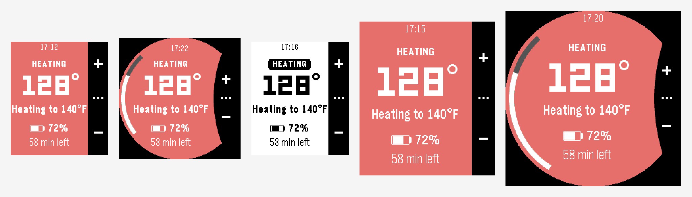
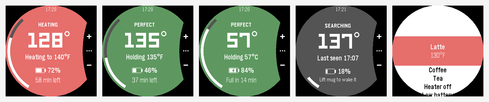
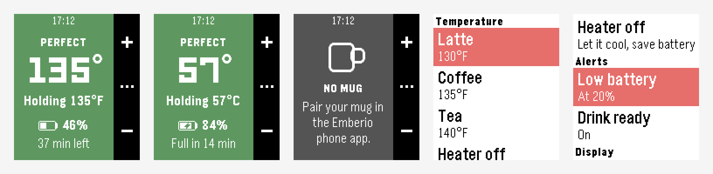

# Emberio

Your Ember mug on your Pebble. See your drink's temperature and how many minutes of heat the
battery has left, change the temperature from your wrist, and get a buzz when your drink is ready
or the battery runs low. Watchfaces can show the readings too, through a Pebble plugin.

Modelled on [Mug Monitor](https://apps.apple.com/app/id6758961574) (temperature and battery at a
glance, plus Latte / Coffee / Tea presets), but for Pebble and Android.

> Unofficial. Not made by, or affiliated with, Ember Technologies or Core Devices.



Round 2: heating, perfect, on the coaster, mug out of reach, and the menu.



Pebble Time: perfect, charging, no mug yet, and the menu.



*Emulator screenshots; the emulator draws the colours lighter than a real screen.*

## What's in here

| | |
|---|---|
| `watch/` | The Pebble watchapp (C) and its watchface plugin (JavaScript), one `.pbw` |
| `android/` | The Android companion app (Kotlin). It talks Bluetooth to the mug |

Pebble watches can't talk Bluetooth to other gadgets, so the phone does it:

```
Ember mug ──Bluetooth LE──▶ Emberio (Android) ──PebbleKit 2──▶ Emberio watchapp
                                  │
                                  └── 127.0.0.1:47811 ──▶ Emberio plugin (in the Pebble app) ──▶ any watchface
```

## Features

**On the watch**

- The drink's temperature, big, on a background that shows what the mug is doing:
  orange heating, blue cooling, green when it's perfect.
- Target temperature, battery percentage, and minutes of heat left (or time to full on the coaster).
- **Up / Down** change the target (1 °F or 0.5 °C a press; hold to go faster). It's sent when you
  stop pressing.
- **Select** opens a menu: Latte, Coffee and Tea presets, heater on/off, alert settings and units.
- If the mug or phone drops out, it shows the last readings and when they were taken.
- Pebble OS look: system fonts, status bar, action bar, menus; round layouts with a curved battery
  gauge on Pebble Time Round and Round 2; touch navigation in menus on Time 2 and Round 2.
- Every Pebble: Pebble/Steel (aplite), Time/Time Steel (basalt), Time Round (chalk),
  Pebble 2 (diorite), Time 2 (emery), Pebble 2 Duo (flint) and Round 2 (gabbro).

**Alerts** (buzz on the watch like any notification)

- **Drink ready**: when the mug gets to your temperature after heating up a fresh pour (or cooling
  down a too-hot one). It won't nag when the mug hovers around the target.
- **Low battery**: when the battery drops to your threshold (Off, 10–50 %, default 20 %), with the
  minutes left. Set it on the watch or in the app.

**On your watchface** (plugin)

The `.pbw` also brings a plugin serving `drink/mug`, so plugin-aware watchfaces, and the Pebble
app's Complications, can show:

| Reading | Example |
|---|---|
| `temperature` | `128°F` |
| `target_temperature` | `140°F` (or `Off`) |
| `state` | `Heating`, `Perfect`, `Cooling`, `Empty`... |
| `battery_level` | `72%` (with a 0–100 range, for gauges) |
| `battery_time_left` | `58m`, `1h05`, `Full 14m` |
| `charging`, `liquid_level`, `name`, `updated` | |

## Install

You need an Android phone with the [Pebble app](https://github.com/coredevices/mobileapp) from
Core Devices (2.0 or later for the watchface plugin), any Pebble, and an Ember mug.

1. Download `emberio.apk` and `emberio.pbw` from the
   [latest release](https://github.com/aleminopuy/emberio/releases/latest) (or from the
   **Build** workflow's artifacts on any commit).
2. Install the APK (allow installing from your browser or file manager when Android asks).
3. Open Emberio, allow Bluetooth and notifications, and pair your mug: hold the button on its
   bottom until the light flashes blue, then tap **Find my mug**.
   *Close the Ember app first; the mug talks to one app at a time.*
4. Open `emberio.pbw` on your phone and choose the Pebble app to install it on your watch. Allow
   its **local network** permission when asked: that's the plugin reading from Emberio on the
   same phone; nothing leaves your phone.
5. Open Emberio on your watch.

To show readings on a watchface: in the Pebble app, **Settings → Plugins → Complications**, add
the Emberio drink readings, then use a plugin-aware watchface (for example Core's
*Complication Face*).

**Keep it running.** Emberio stays connected in the background (with a quiet status
notification) so alerts can fire. On phones that are strict about background apps, tap
**Allow** on the *Stay connected* card. See [dontkillmyapp.com](https://dontkillmyapp.com) if
alerts still stop.

## How "minutes left" works

Ember doesn't report it, so Emberio works it out. It starts from Ember's rated battery life for
your model (Mug 2: 90 min for 10 oz, 80 min for 14 oz; Cup 90 min; Tumbler and Travel Mug
3 hours), then times how fast your mug's percentage actually drops while it's keeping a drink
hot, and blends that in the longer it watches. Time spent empty or asleep doesn't count. At the
end of each session it remembers your mug's real drain rate, so the estimate starts out better
next time. On the coaster it shows time to full instead.

## Mugs

Written for the **Ember Mug 2**, using the Bluetooth protocol the community libraries above use
with it. The Mug (1st gen), Cup, Tumbler and Travel Mug speak the same protocol and should work.
None of it has been tried against a real mug yet (it was developed against the protocol and the
Pebble emulators), so the first run on real hardware is the real test; reports welcome.

Changing the temperature needs the mug to accept writes. A mug set up in the Ember app does; a
mug that was reset gets unlocked by Emberio automatically. If changes don't stick, set the mug
up once in the Ember app, close that app, and try again.

## Limitations

- Android only. iOS has no way for third-party apps to talk to the Pebble app like this.
- Needs Core's Pebble app (PebbleKit 2). Gadgetbridge and the original 2016 Pebble app aren't
  supported.
- Plugins are new and still a preview in the Pebble app. Plugins can't talk to Android apps
  directly yet, so the plugin reads Emberio's state from `127.0.0.1:47811` on the phone (read-only).
- One mug at a time.

## Building

**Watch** (needs the [Pebble SDK](https://developer.repebble.com/sdk/): `uv tool install pebble-tool`
then `pebble sdk install latest`):

```sh
cd watch
pebble build                      # build/watch.pbw
node --test test/*.test.cjs       # plugin tests
pebble install --emulator gabbro  # try it on the Round 2 emulator
EMBERIO_DEMO=1 pebble build       # canned data for screenshots (1-5); see tools/screenshots.sh
```

**Android** (JDK 17+, Android SDK with platform 37):

```sh
cd android
./gradlew testDebugUnitTest assembleDebug   # app/build/outputs/apk/debug/app-debug.apk
```

CI (`.github/workflows/build.yml`) builds both on every push. To release, publish a release on
GitHub (website or app: **Releases → Draft a new release**, type a new tag such as `v1.0.1`,
**Publish**); a few minutes later CI attaches `emberio.apk` and `emberio.pbw` to it, built from
that tag. To sign releases with your own key (so updates install over
the previous version), add repository secrets `EMBERIO_KEYSTORE_BASE64`,
`EMBERIO_KEYSTORE_PASSWORD`, `EMBERIO_KEY_ALIAS` and `EMBERIO_KEY_PASSWORD`. Without them each
build is signed with a throwaway key, and you'll need to uninstall before installing a newer one.

## Credits

The Ember Bluetooth protocol was worked out by the community, especially
[python-ember-mug](https://github.com/sopelj/python-ember-mug) and
[mugctl](https://github.com/zopieux/mugctl). Watch-to-phone messaging uses
[PebbleKit Android 2](https://github.com/pebble-dev/PebbleKitAndroid2).
